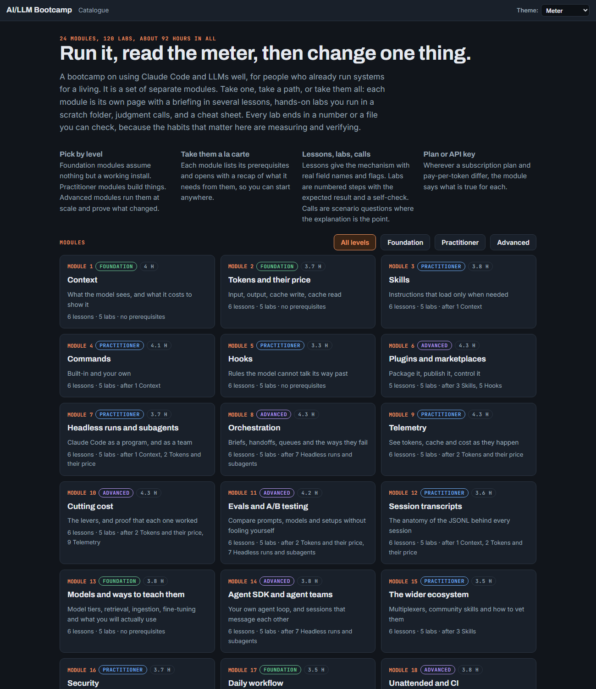
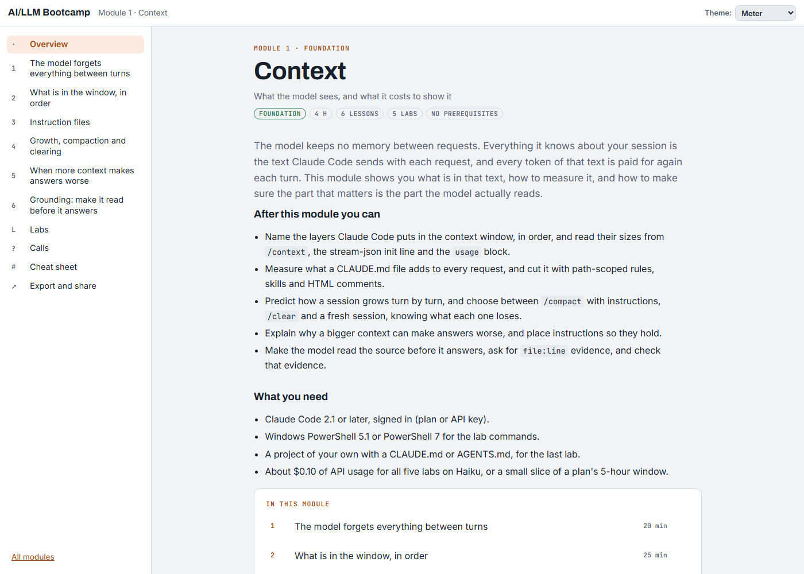

<div align="center">

# AI/LLM Bootcamp

**Run it, read the meter, then change one thing.**<br>
A hands-on course on Claude Code and LLMs, for people who already run systems for a living.

    



</div>

## What it is

A bootcamp in 24 modules and 120 labs, built as plain static HTML. Each module is its own page with a briefing in several lessons, **labs you run in a scratch folder**, judgment calls, a drill and a cheat sheet. Every lab ends in a number or a file you can check, because the habits that matter here are measuring and verifying.

Topics: context, tokens and cost, skills, commands, hooks, plugins, headless runs and subagents, orchestration, telemetry, evals and A/B testing, session transcripts, model choice.

**Who it's for:** engineers, admins and platform people who already run systems and want to use Claude Code and the Claude API well, with evidence rather than folklore. Take one module, a path, or all of them: each module lists its prerequisites and opens with a recap of what it needs from them, so you can start anywhere.

## Open it

Open **`dist/index.html`** in a browser. That's the whole install.

- Works offline from a `file://` path, and behind any static web server.
- Keep the `dist/` folder together: the module pages sit beside the catalogue and link to each other.
- Progress is stored per module in your browser; each module's overview has a progress code that carries it to another browser.
- Pages ask Google Fonts for their typefaces when online and fall back to system fonts offline.

<div align="center">

<br><sub>A module page: lessons down the left, outcomes and what you need up front.</sub>
</div>

## Pick by level

Foundation modules assume nothing but a working install. Practitioner modules build things. Advanced modules run them at scale and prove what changed. The catalogue's level filter shows each tier:

### Foundation

*Assume nothing but a working install.*


### Practitioner

*Build things.*


### Advanced

*Run it at scale and prove what changed.*


## Modules

All 24 modules are written: 120 labs, about 92 hours in all. The links below open the built pages from a clone; on GitHub they show the HTML source, so clone the repo (or download it as a zip) and open the files locally.

| # | Module | Level | Time | What you learn |
| ---: | --- | --- | ---: | --- |
| 1 | [Context](dist/m01-context.html) | Foundation | 4.0 h | What the model sees, and what it costs to show it |
| 2 | [Tokens and their price](dist/m02-tokens.html) | Foundation | 3.7 h | Input, output, cache write, cache read |
| 3 | [Skills](dist/m03-skills.html) | Practitioner | 3.8 h | Instructions that load only when needed |
| 4 | [Commands](dist/m04-commands.html) | Practitioner | 4.1 h | Built-in and your own |
| 5 | [Hooks](dist/m05-hooks.html) | Practitioner | 3.3 h | Rules the model cannot talk its way past |
| 6 | [Plugins and marketplaces](dist/m06-marketplaces.html) | Advanced | 4.3 h | Package it, publish it, control it |
| 7 | [Headless runs and subagents](dist/m07-agents.html) | Practitioner | 3.7 h | Claude Code as a program, and as a team |
| 8 | [Orchestration](dist/m08-orchestration.html) | Advanced | 4.3 h | Briefs, handoffs, queues and the ways they fail |
| 9 | [Telemetry](dist/m09-telemetry.html) | Practitioner | 4.3 h | See tokens, cache and cost as they happen |
| 10 | [Cutting cost](dist/m10-cost.html) | Advanced | 4.3 h | The levers, and proof that each one worked |
| 11 | [Evals and A/B testing](dist/m11-ab-testing.html) | Advanced | 4.2 h | Compare prompts, models and setups without fooling yourself |
| 12 | [Session transcripts](dist/m12-transcripts.html) | Practitioner | 3.6 h | The anatomy of the JSONL behind every session |
| 13 | [Models and ways to teach them](dist/m13-models.html) | Foundation | 3.8 h | Model tiers, retrieval, ingestion, fine-tuning and what you will actually use |
| 14 | [Agent SDK and agent teams](dist/m14-agent-sdk.html) | Advanced | 3.8 h | Your own agent loop, and sessions that message each other |
| 15 | [The wider ecosystem](dist/m15-ecosystem.html) | Practitioner | 3.5 h | Multiplexers, community skills and how to vet them |
| 16 | [Security](dist/m16-security.html) | Practitioner | 3.7 h | Permissions, sandboxing, prompt injection and what you install |
| 17 | [Daily workflow](dist/m17-workflow.html) | Foundation | 3.5 h | Plan mode, rewind, worktrees, effort and git habits |
| 18 | [Unattended and CI](dist/m18-ci.html) | Advanced | 3.8 h | GitHub Actions, review in the pipeline, scheduled runs |
| 19 | [Claude API building blocks](dist/m19-api.html) | Practitioner | 3.7 h | Tool use, structured outputs, vision, citations, batch, computer use |
| 20 | [Writing for agents](dist/m20-writing.html) | Foundation | 3.8 h | Briefs, specs, handoffs and CLAUDE.md design |
| 21 | [Where Claude Code runs](dist/m21-surfaces.html) | Foundation | 2.8 h | Terminal, VS Code, JetBrains, desktop and web compared |
| 22 | [Sensitive data](dist/m22-sensitive-data.html) | Practitioner | 4.4 h | PHI, PII and secrets: what leaves the machine and how to stop it |
| 23 | [MCP: anatomy of the protocol](dist/m23-mcp.html) | Practitioner | 3.8 h | JSON-RPC, capabilities, transports, auth, and a server you build |
| 24 | [MCP server or CLI tool](dist/m24-mcp-or-cli.html) | Advanced | 3.8 h | The same job both ways, measured in tokens and turns |

## Layout

| Path | What it is |
| --- | --- |
| `site/` | Source: `page.html` frame, `style.css`, `app.js`, `tools.js` (the in-page calculators), `catalogue.html`, one `mNN-*.html` fragment per module, `diagrams/` (pre-rendered SVG) |
| `dist/` | The built course (committed): `index.html` and one self-contained page per module |
| `tools/` | Build and check helpers (below) |
| `reference/` | Fact sheets the modules were written from, with their source links |
| `docs/images/` | The screenshots on this page |

## Build

Requires Windows PowerShell 5.1 or PowerShell 7, and Node 18 or later. No packages.

```powershell
powershell.exe -NoProfile -ExecutionPolicy Bypass -File site/build.ps1   # writes dist/ and out/ai-bootcamp.zip
node tools/test-tools.js                                                   # maths behind the in-page calculators
node tools/render-diagrams.mjs --check                                     # every Mermaid block has a rendered SVG
node tools/render-diagrams.mjs                                             # render missing diagrams (Chrome, Mermaid pinned and hash-checked)
powershell.exe -NoProfile -ExecutionPolicy Bypass -File tools/shoot.ps1 -Shots 'index.html|1300x1600'   # headless screenshot
node tools/public-scan.js                                                  # public-release scan (below)
```

Labs that run `claude -p` can be wrapped with `tools/lab-run.ps1`, which keeps your own settings, hooks and MCP servers out of the run.

## Themes

Five themes (`?style=a` to `?style=e`) in light and dark (`?mode=light` or `?mode=dark`), also picked from the **Theme** menu in the page header. The screenshots above use the default light theme.

## Before you publish a change

`node tools/public-scan.js` greps the whole tree for emails, private host names and addresses, internal domains, local paths, tracker ids, secrets, and image metadata, and exits non-zero on a hit. Keep your own private patterns (names, employer) one regex per line in a file named by the `PUBLIC_SCAN_EXTRA` environment variable, or in `tools/.scan-extra.txt` (git-ignored). To run it on every commit:

```sh
cp tools/pre-commit.sample .git/hooks/pre-commit && chmod +x .git/hooks/pre-commit
```

## Sources and credits policy

- Every claim about a product comes from its public documentation, linked in the module's sources block, or from a run you can repeat with the labs. Where the documentation is silent, the module says so and gives you the lab that finds out.
- Measured numbers (tokens, cost, timings) are from real runs in November 2026 on the versions named beside them. Yours will differ a little; the shape should not.
- Vendor names and product names belong to their owners. This course is independent and is not affiliated with or endorsed by Anthropic.
- Examples use placeholder names (acme, web-01, example.com). The course contains no employer code or data.
- Mermaid (MIT) renders the diagrams at build time; the pages carry the resulting SVG and no library.

## Licence

- **Code** (`tools/`, `site/build.ps1`, `site/app.js`, `site/tools.js`, and other scripts): MIT, see [`LICENSE`](LICENSE).
- **Content** (the lessons, labs, drills, diagrams, and reference sheets, including the built pages in `dist/`): Creative Commons Attribution 4.0 International, see [`LICENSE-CONTENT.md`](LICENSE-CONTENT.md).
