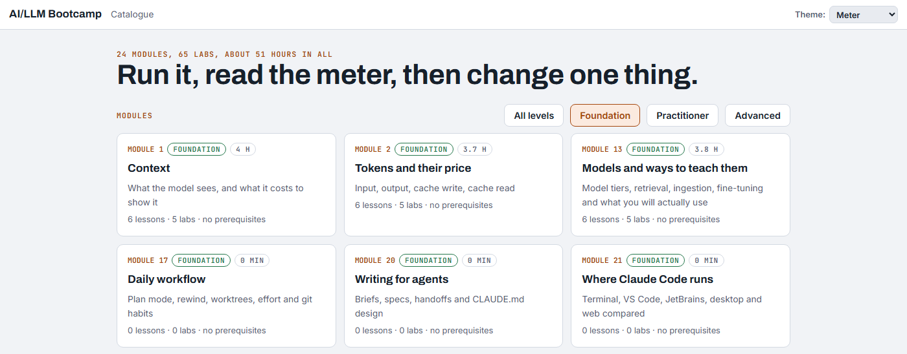
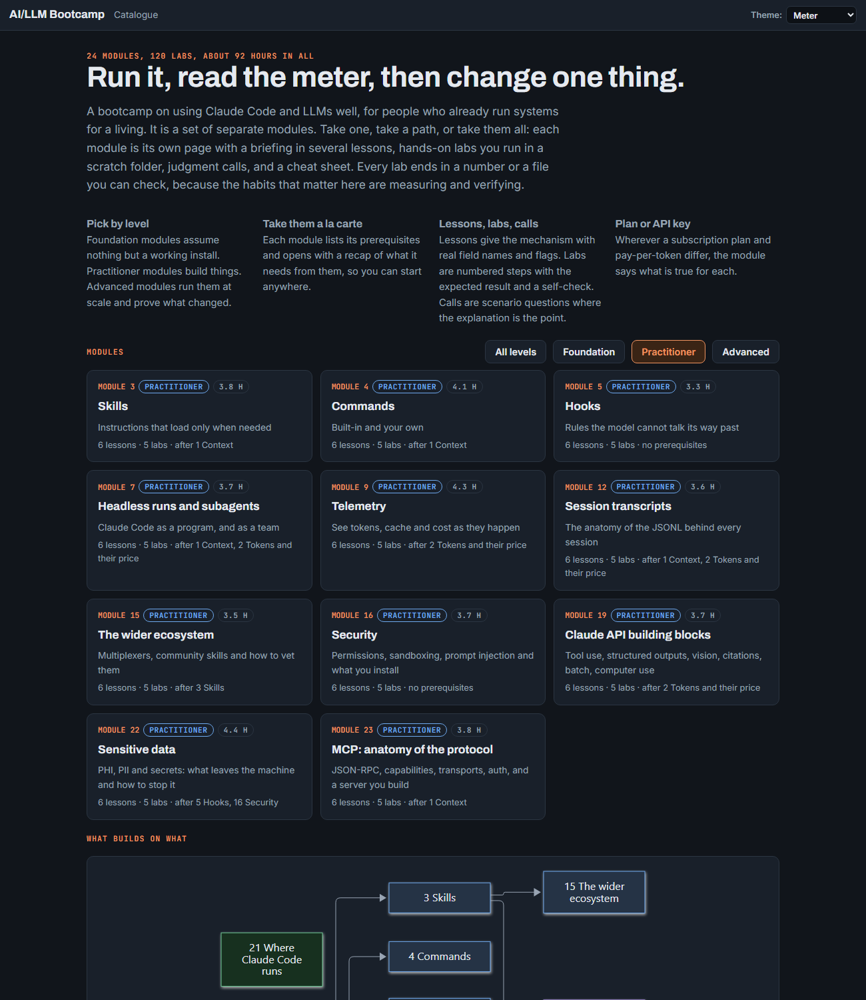
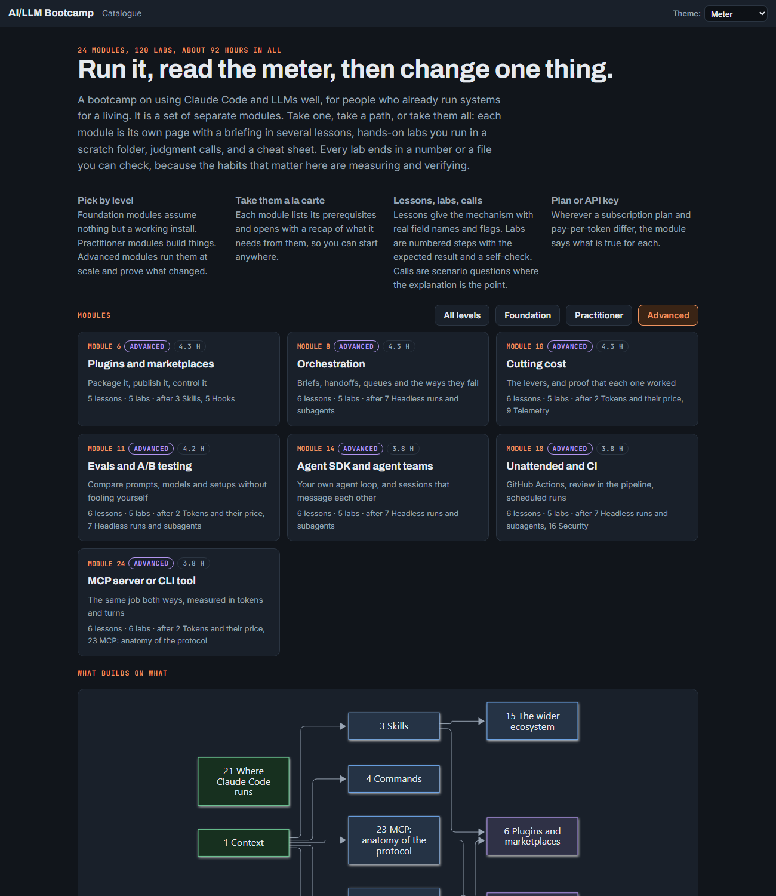

# AI/LLM Bootcamp

**Run it, read the meter, then change one thing.**

A hands-on course on Claude Code and LLMs in 24 modules and 120 labs. Each module is one page: short lessons, labs that end in a number or a file you can check, a drill and a cheat sheet. It runs in your web browser, offline, with nothing to install.

## Start here

You need only Claude Code, working in a terminal. Copy this prompt, paste it into Claude Code and press Enter:

```text
Set up the AI/LLM Bootcamp course for me. I am new to this, so before each step tell me in one plain sentence what it does.
1. Download the course from https://github.com/Muqluk/ai-bootcamp into a folder named ai-bootcamp in my home folder, so that ai-bootcamp/dist/index.html exists. Use git if it is installed; if not, download https://github.com/Muqluk/ai-bootcamp/archive/refs/heads/main.zip and unzip it there. If the folder is already there, update it instead.
2. Make an empty folder named bootcamp-labs in my home folder. The course's labs work in it and call it ~/bootcamp-labs.
3. Open ai-bootcamp/dist/index.html in my web browser.
4. Tell me the full path of both folders.
Do not install anything and do not change any settings.
```

Claude asks before it runs each command. Read what it is about to run, then allow it: checking what the model does is the habit this course teaches. When the catalogue opens in your browser, start with any Foundation module.

## Pick by level

### Foundation

*Assume nothing but a working Claude Code.*



### Practitioner

*Build things.*



### Advanced

*Run it at scale and prove what changed.*



## Modules

About 92 hours in all. Each module lists its prerequisites and opens with a recap of them, so you can start anywhere. The links open the pages once the course is on your computer (the prompt above does that); on GitHub they show the page source.

| # | Module | Level | Time | What you learn |
| ---: | --- | --- | ---: | --- |
| 1 | [Context](dist/m01-context.html) | Foundation | 4.0 h | What the model sees, and what it costs to show it |
| 2 | [Tokens and their price](dist/m02-tokens.html) | Foundation | 3.7 h | Input, output, cache write, cache read |
| 3 | [Skills](dist/m03-skills.html) | Practitioner | 3.8 h | Instructions that load only when needed |
| 4 | [Commands](dist/m04-commands.html) | Practitioner | 4.1 h | Built-in and your own |
| 5 | [Hooks](dist/m05-hooks.html) | Practitioner | 3.3 h | Rules the model cannot talk its way past |
| 6 | [Plugins and marketplaces](dist/m06-marketplaces.html) | Advanced | 4.3 h | Package it, publish it, control it |
| 7 | [Headless runs and subagents](dist/m07-agents.html) | Practitioner | 3.7 h | Claude Code as a program, and as a team |
| 8 | [Orchestration](dist/m08-orchestration.html) | Advanced | 4.3 h | Briefs, handoffs, queues and the ways they fail |
| 9 | [Telemetry](dist/m09-telemetry.html) | Practitioner | 4.3 h | See tokens, cache and cost as they happen |
| 10 | [Cutting cost](dist/m10-cost.html) | Advanced | 4.3 h | The levers, and proof that each one worked |
| 11 | [Evals and A/B testing](dist/m11-ab-testing.html) | Advanced | 4.2 h | Compare prompts, models and setups without fooling yourself |
| 12 | [Session transcripts](dist/m12-transcripts.html) | Practitioner | 3.6 h | The anatomy of the JSONL behind every session |
| 13 | [Models and ways to teach them](dist/m13-models.html) | Foundation | 3.8 h | Model tiers, retrieval, ingestion, fine-tuning and what you will actually use |
| 14 | [Agent SDK and agent teams](dist/m14-agent-sdk.html) | Advanced | 3.8 h | Your own agent loop, and sessions that message each other |
| 15 | [The wider ecosystem](dist/m15-ecosystem.html) | Practitioner | 3.5 h | Multiplexers, community skills and how to vet them |
| 16 | [Security](dist/m16-security.html) | Practitioner | 3.7 h | Permissions, sandboxing, prompt injection and what you install |
| 17 | [Daily workflow](dist/m17-workflow.html) | Foundation | 3.5 h | Plan mode, rewind, worktrees, effort and git habits |
| 18 | [Unattended and CI](dist/m18-ci.html) | Advanced | 3.8 h | GitHub Actions, review in the pipeline, scheduled runs |
| 19 | [Claude API building blocks](dist/m19-api.html) | Practitioner | 3.7 h | Tool use, structured outputs, vision, citations, batch, computer use |
| 20 | [Writing for agents](dist/m20-writing.html) | Foundation | 3.8 h | Briefs, specs, handoffs and CLAUDE.md design |
| 21 | [Where Claude Code runs](dist/m21-surfaces.html) | Foundation | 2.8 h | Terminal, VS Code, JetBrains, desktop and web compared |
| 22 | [Sensitive data](dist/m22-sensitive-data.html) | Practitioner | 4.4 h | PHI, PII and secrets: what leaves the machine and how to stop it |
| 23 | [MCP: anatomy of the protocol](dist/m23-mcp.html) | Practitioner | 3.8 h | JSON-RPC, capabilities, transports, auth, and a server you build |
| 24 | [MCP server or CLI tool](dist/m24-mcp-or-cli.html) | Advanced | 3.8 h | The same job both ways, measured in tokens and turns |

## For contributors

The source is in `site/`, the built pages in `dist/`, and the build and check helpers in `tools/`. Rebuilding needs PowerShell and Node 18 or later, and no packages. After editing, paste this into Claude Code from the `ai-bootcamp` folder:

```text
Rebuild this course and check it: run site/build.ps1 with PowerShell, then node tools/test-tools.js, node tools/render-diagrams.mjs --check and node tools/public-scan.js. Tell me whether each one passed and show any failure in full. Change nothing else.
```

`tools/public-scan.js` must pass before you publish a change. It reads extra private patterns, one regex per line, from the file named by the `PUBLIC_SCAN_EXTRA` environment variable or from `tools/.scan-extra.txt` (git-ignored).

This course is independent and not affiliated with or endorsed by Anthropic. Product claims link to public documentation in each module's sources block, and measured numbers come from runs in November 2026.

## Licence

Code is MIT ([`LICENSE`](LICENSE)); content, including the built pages in `dist/`, is CC BY 4.0 ([`LICENSE-CONTENT.md`](LICENSE-CONTENT.md)).
